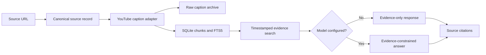

# Knowledge Forge

**Local-first evidence retrieval and grounded AI-assisted answers — Python, FastAPI, SQLite FTS5.**

[](https://github.com/maiarcaio/knowledge-forge/actions/workflows/python-tests.yml)

An independent engineering project that stores source references and available YouTube captions, searches transcript passages and returns timestamp-linked supporting evidence. An optional OpenAI-compatible model can answer questions using the retrieved excerpts; without a configured provider, the application remains useful in **evidence-only mode**.

**Why I built it:** Research and learning often produce notes that lose the exact original source. Knowledge Forge preserves source context so an answer can be checked against the material it came from.

## See the engineering work

| Capability | Current implementation |
| --- | --- |
| API and validation | FastAPI routes with Pydantic requests |
| Persistence | SQLite source/collection records, caption chunks and FTS5 text index |
| Ingestion | YouTube caption adapter when captions are publicly available; canonical URL deduplication |
| Retrieval | SQLite FTS5 full-text search, with timestamped source links |
| Answer generation | Optional OpenAI-compatible API; no provider key required for evidence-only mode |
| Export | Markdown export for stored source evidence |
| Verification | pytest + GitHub Actions Python 3.12 install-and-test checks |

**Implementation:** [API](knowledge_forge/app.py) · [Storage/search](knowledge_forge/library.py) · [Answer/citations](knowledge_forge/chat.py) · [Tests](tests/) · [Evaluation protocol](docs/EVALUATION.md)

**Scope and limits:** This is a working **local prototype**, not a deployed production service. Semantic embeddings, hybrid/vector retrieval, a completed benchmark, automatic Instagram transcription and sync are **not implemented**. Linked timestamps make evidence inspectable, but do not independently prove factual grounding or answer correctness.

## How it works



Instagram URLs can be stored as source records, but their content is not automatically extracted. See [Instagram feasibility notes](docs/INSTAGRAM_FEASIBILITY.md).

## Run locally

**Prerequisite:** Python 3.12+.

```bash
python3 -m venv .venv
.venv/bin/python -m pip install -e '.[dev]'
cp .env.example .env
set -a; source .env; set +a
.venv/bin/uvicorn knowledge_forge.app:app --reload
```

Open [http://127.0.0.1:8000](http://127.0.0.1:8000) for the local interface and [http://127.0.0.1:8000/docs](http://127.0.0.1:8000/docs) for FastAPI's interactive API reference.

A basic local workflow is: save a public YouTube URL, run caption ingestion if captions are available, search for a phrase, open the timestamped source, and optionally ask a question. External caption availability may vary.

Local data is written under `data/`, which is Git-ignored.

## Selected API endpoints

| Endpoint | Purpose |
| --- | --- |
| `POST /api/sources` | Register a source URL |
| `POST /api/sources/{id}/ingest` | Attempt YouTube caption ingestion; return a manual/permission-aware next step for Instagram |
| `GET /api/sources/{id}` | Inspect saved source metadata |
| `GET /api/sources/{id}/export.md` | Export source evidence as Markdown |
| `GET /api/search?q=...` | Find matching timestamped evidence |
| `POST /api/chat` | Return an answer and supporting citations |
| `POST /api/collections` | Create a source collection |

## Testing and reproducibility

```bash
.venv/bin/python -m pytest
.venv/bin/ruff check .
```

**Verified GitHub Actions run:** [Python checks — October 29, 2026](https://github.com/maiarcaio/knowledge-forge/actions/runs/40865502016) completed successfully. The workflow executes dependency installation and the deterministic pytest suite on Python 3.12. Ruff is available in the development dependency set, but is not yet a blocking CI step.

These checks validate local application behavior. They do not measure live caption availability, LLM answer quality or deployment reliability. The [evaluation protocol](docs/EVALUATION.md) specifies a future manual factual-citation benchmark; scores have not yet been established.

## Architecture and safety decisions

- **Evidence before generation:** retain local source data and transcript excerpts rather than treating model output as the system of record.
- **Retrieval baseline first:** start with exact lexical search, then add semantic/hybrid retrieval only after comparing it on a reproducible evaluation set.
- **Provider isolation:** the optional model receives selected retrieved evidence through an OpenAI-compatible adapter, not the entire local source library.
- **Privacy-aware scope:** this repository contains original code, public/synthetic fixtures and docs—not private transcripts or user credentials.

Read [PRIVACY.md](PRIVACY.md) before adding connectors. Do not commit `data/`, `.env`, cookies, provider keys or protected media.

## Next engineering milestones

1. Build a reproducible question-and-evidence benchmark and record successes, errors and citation misses.
2. Compare SQLite FTS5 baseline with a small semantic/hybrid retrieval adapter.
3. Add tracing and cost/latency measurements where applicable.
4. Consider user-permitted media upload/transcription after privacy and rights review.

**Authorship:** independent project by [@maiarcaio](https://github.com/maiarcaio). Coursework projects and collaborative applications are documented separately in [my portfolio](https://github.com/maiarcaio).
